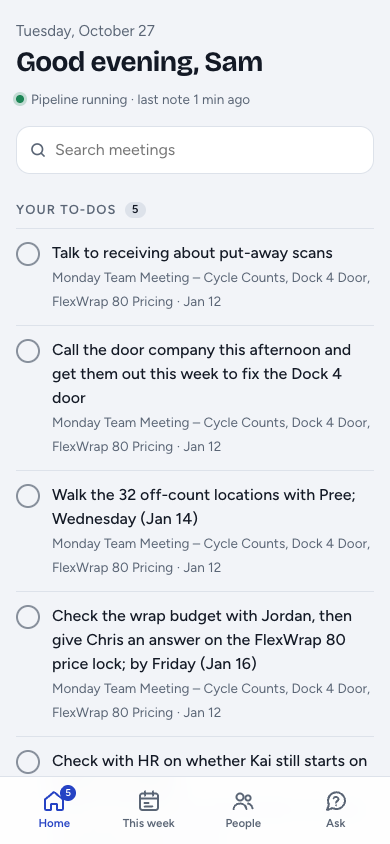
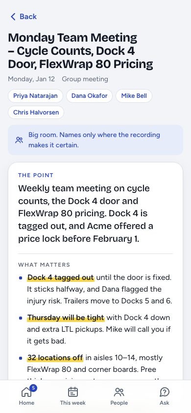

# app/: the Meeting Notes app

A phone and iPad web app for your notes. It leads with what matters instead of the whole note. It runs on your Mac and has no build step or dependencies (Python standard library and plain JavaScript). Turn it on with `./install.sh --with app`.

  
  &nbsp;
  

## What's in it

- **Home:** your open to-dos across all meetings, things you're waiting on from other people, recordings still being processed, search, and recent meetings. To-dos you'd hand off to someone are behind "Show N to hand off".
- **Each meeting starts with a TL;DR card:** the point in one sentence, the 3 to 5 things that matter, your to-dos and who owes you what. Each item has a ▶ timestamp that plays the recording from that moment. The full note is folded below.
- **This week:** the week's meetings as cards, readable in a couple of minutes.
- **People:** what's open between you and each person, and "bring up next time".
- **Ask:** questions answered only from your notes, with links to the meetings it used.
- **Buttons on a meeting:**
  - **Listen**
  - **Fix this note:** say what's wrong in plain words, and the note is redone.
  - **Add photos & notes:** whiteboards, slides, handouts. The text is read on your Mac with Apple Vision and added to the note.
  - **Delete this meeting:** moves everything to `~/.meeting-notes/deleted/`, so it can be undone.
- **Works offline.** The last copy stays readable with no signal, and you can add it to your Home Screen.

The TL;DR cards are made with one small `claude -p` call per note version, in the background, and saved next to the note, never inside it.

## Using it on your phone (Tailscale)

The server listens on `127.0.0.1` only, so nothing on your Wi-Fi or the internet can reach it. To use it from your phone, put it on your private [Tailscale](https://tailscale.com) network (free for personal use):

1. Install Tailscale on the Mac and your phone, and sign in to both with the same account.
2. On the Mac: `tailscale serve --bg 8787`. The first time, it gives you a link to turn on Serve and HTTPS for your tailnet.
3. Open `https://<your-mac-name>.<your-tailnet>.ts.net` on your phone (`tailscale serve status` shows it). In Safari, tap Share › **Add to Home Screen**.

Only your own devices can open it. If you use a VPN-based DNS blocker like AdGuard on iOS, only one VPN can be on at a time. Use Tailscale, and set its DNS to your blocker's DNS servers in the Tailscale admin console.

## Safety

- It only answers requests addressed to `localhost` or `*.ts.net`, which blocks DNS-rebinding tricks.
- Every change needs a custom `X-App` header, so other websites can't submit forms to it.
- Static files can't escape the `static/` folder, photo names are checked against a strict pattern, and uploads must be real JPEGs.
- Its data lives in `~/.meeting-notes/app/` (folder mode 700): TL;DR cards, ticked to-dos, photos and an audio cache.

## Files

`server.py` (HTTP and data) · `notes.py` (reads notes; read-only except for ticking boxes) · `tldr.py` (TL;DR cards) · `actions.py` (what the buttons do) · `static/` (the front end)

Run it by hand with `python3 app/server.py`. It's the `com.meetingnotes.app` background job, and its logs are in `~/Library/Logs/meeting-notes/app.*` and `~/.meeting-notes/app/*.log`.
