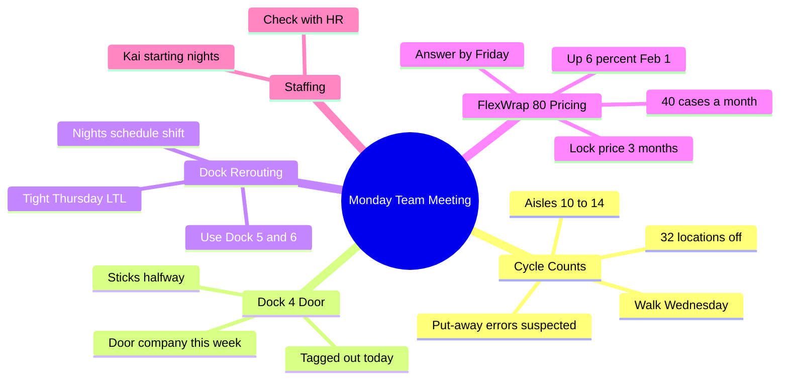

# Monday Team Meeting – Cycle Counts, Dock 4 Door, FlexWrap 80 Pricing

**Cadence:** Weekly, Mondays

## Summary

The weekly team meeting covered three topics. A cycle count in aisles 10–14 found 32 locations off, and the team thinks the cause is put-away errors in receiving rather than shrink. Dock 4's door is being tagged out because it sticks halfway, so its trailers will move to Dock 5 and Dock 6. [[Acme Pallet Co.]] is raising the FlexWrap 80 price on February 1 and offered to lock the current price if we commit to three months.

## Attendees

- [[Sam Quill]] — Operations Manager (me; ran the meeting)
- [[Priya Natarajan|Pree]] — Inventory Lead
- [[Dana Okafor|Dana]] — Safety Coordinator
- [[Mike Bell|Mike]] — Dispatch Lead, nights
- [[Chris Halvorsen|Chris]] — sales rep, Acme Pallet Co. (by speakerphone)

**Mentioned (not present):**

- [[Jordan Lee|Jordan]] — Regional Director (needs to approve the wrap budget)
- Kai — expected to start on nights next week

## Decisions

- Dock 4 gets tagged out until the door is repaired.
- Dock 4's trailers will run through Dock 5 and Dock 6 for now.
- The team will walk the 32 off-count locations on Wednesday.

## My Action Items

- [ ] Talk to receiving about put-away scans
- [ ] Call the door company this afternoon and get them out this week to fix the Dock 4 door
- [ ] Walk the 32 off-count locations with Pree; Wednesday (Jan 14)
- [ ] Check the wrap budget with Jordan, then give Chris an answer on the FlexWrap 80 price lock; by Friday (Jan 16)
- [ ] Check with HR on whether Kai still starts on nights next week

## What Others Are Working On

- **Priya Natarajan** — pull the list of the 32 off-count locations for Sam; Tuesday end of day (Jan 13)
- **Dana Okafor** — tag out Dock 4 right after the meeting
- **Mike Bell** — change the nights schedule so Dock 4's trailers go through Dock 5 and Dock 6

## Cycle Counts

- **Results:** The cycle count for aisles 10–14 found about 32 locations off, mostly FlexWrap 80 and corner boards.
- **Likely cause:** Pree thinks receiving is putting items away in the wrong slots, so she doesn't see it as actual shrink.
- **Next:** Pree sends the location list by Tuesday, the team walks the locations Wednesday, and Sam talks to receiving about put-away scans.

## Dock 4 Door

- **Problem:** The door still sticks halfway. Dana raised the risk that someone will get hurt ducking under it.
- **Fix:** Dana tags it out today, and Sam calls the door company to get a repair this week.
- **Workaround:** Trailers move to Dock 5 and Dock 6. Mike says nights can handle it, but Thursday will be tight because of the extra LTL pickups. Sam asked Mike to call him if Thursday gets bad.

## FlexWrap 80 Pricing (Acme Pallet Co.)

- **Price increase:** FlexWrap 80 goes up about 6% on February 1.
- **Offer:** Chris can lock the current price if we commit to the next three months at about 40 cases a month.
- **Our usage:** Sam said 40 cases is about what we use. He wants to confirm the budget with Jordan before committing and will answer by Friday. Chris agreed.

## Open Issues

- No one has seen paperwork for Kai's start on nights next week.
- Thursday's dock capacity with Dock 4 down and the extra LTL pickups.

## Unclear in the Recording

- Kai's last name and role weren't stated. Only that Kai is expected to start on nights.
- I took "Mike" to be Mike Bell (Dispatch Lead, nights). He was named, and he spoke for the nights schedule.
- The Tuesday, Wednesday and Friday dates come from the meeting date (Monday, Jan 12). Only the weekday names were said.

## Mind Map

